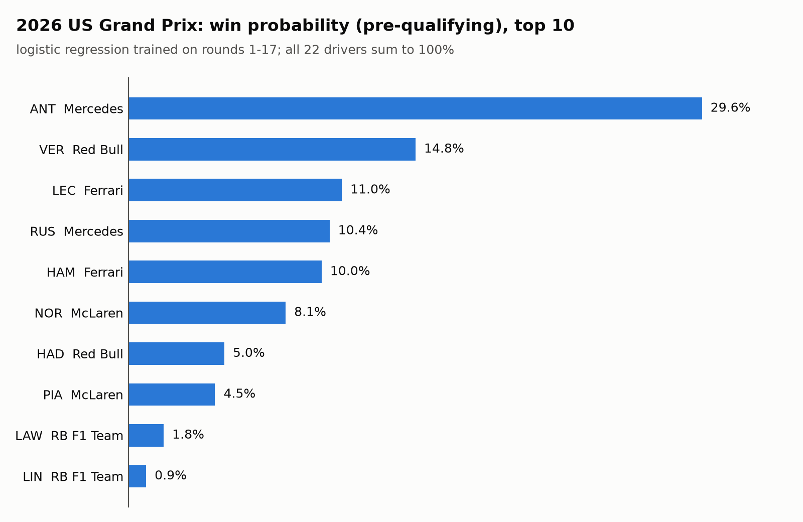

# Austin F1 Predictor

Win probabilities for every driver in the **2026 Formula 1 United States Grand Prix** at the Circuit of the Americas (COTA), Austin, on **October 25, 2026** (round 18 of the season).

The output is a probability for each of the 22 drivers, summing to 100%, not a single pick. There are two predictions:

- **Pre-qualifying:** uses season form only. Available now.
- **Post-qualifying:** adds the grid and qualifying pace. Run after qualifying on Saturday, October 24.

The 2026 season started a new set of chassis and power-unit regulations, which reset the competitive order. The models therefore use 2026 data only. Older seasons don't say much about which cars are quick under the new rules.

## Data source

All data comes from [FastF1](https://docs.fastf1.dev/), which wraps the official F1 live-timing feed and the Jolpica (Ergast-compatible) results API:

- race and qualifying results for the 17 completed 2026 rounds
- official driver standings after each round (these include sprint points, which race results alone miss)
- race and qualifying results for the 2023, 2024 and 2025 US Grands Prix
- practice and qualifying sessions for the 2026 US GP, fetched during the race weekend

Downloaded data goes to `data/` and the FastF1 cache to `cache/`. Neither is committed, so the first run downloads everything.

## Project structure

```
src/
  config.py         Project paths; enables the FastF1 cache in cache/
  collect_data.py   Downloads results and standings to data/ (--weekend for US GP sessions)
  features.py       Builds one row per driver per race -> data/features.csv
  baseline.py       Scores simple winner-picking rules -> outputs/baselines.csv
  model.py          Walk-forward backtest, saves the best model per stage -> outputs/*.pkl
  calibrate.py      Fits temperature scaling for the post-qualifying model (optional)
  predict.py        Predicts the US GP -> outputs/prediction_*_quali.csv and .png
notebooks/
  explore.ipynb     Standings, winners, pole conversion, recent form, data quirks
outputs/            Predictions, charts, saved models and backtest tables
data/, cache/       Downloaded data (git-ignored)
```

## Setup

Requires Python 3.10 or newer. The project uses a standard `venv` (not conda):

```bash
python3 -m venv .venv
.venv/bin/python -m pip install -r requirements.txt
```

`requirements.txt` pins every installed package for exact reproduction. `requirements-core.txt` lists only the six direct dependencies (fastf1, pandas, numpy, scikit-learn, matplotlib, jupyter) if you prefer to resolve the rest yourself.

Commands below call `.venv/bin/python` directly, so they work even if another environment (such as conda base) is active. To use the notebook, register the kernel once:

```bash
.venv/bin/python -m ipykernel install --user --name austin-f1-predictor \
  --display-name "Python 3.12 (austin-f1-predictor .venv)"
```

## Running the pipeline

Run the scripts in this order:

```bash
# 1. Download 2026 results, standings and US GP history (first run takes a few minutes)
.venv/bin/python src/collect_data.py

# 2. Build the feature table
.venv/bin/python src/features.py

# 3. Score the baselines
.venv/bin/python src/baseline.py

# 4. Backtest the models and save the best one for each stage
.venv/bin/python src/model.py

# 5. (Optional) Fit temperature scaling for the post-qualifying model. Re-run after step 4.
.venv/bin/python src/calibrate.py

# 6. Predict the US GP before qualifying
.venv/bin/python src/predict.py --stage pre
```

After qualifying (October 24, 21:00 UTC):

```bash
# Fetches the weekend sessions, then predicts with the grid and qualifying gaps
.venv/bin/python src/predict.py --stage post

# Same, with temperature scaling applied (off by default, see "Decisions tested")
.venv/bin/python src/predict.py --stage post --calibrated
```

`collect_data.py --weekend` can be run on its own at any point during the weekend. It skips sessions that haven't happened yet.

## Features

Every feature uses only information available before the race starts. A test rebuilds each race's features after shuffling that race's results and marking every driver as retired. The features come out identical for all 17 rounds, so nothing from a race's result leaks into its own prediction.

| Feature | What it is | Why |
|---|---|---|
| `avg_finish_prev5` | Driver's mean finishing position over their previous 5 races | Recent driver form |
| `form_ewm` | Exponentially weighted mean finish over all earlier races, half-life 2 races | Weights the latest races most, so a driver on a hot streak is noticed sooner |
| `points_share_before` | Driver's official points divided by the leader's, after the previous round | Season-long strength on a 0 to 1 scale that doesn't grow through the season like raw points |
| `team_avg_finish_prev5` | Mean finish of both team cars over the team's previous 5 rounds | Car performance, which dominates F1 results |
| `dnf_rate_before` | Share of the driver's earlier races not classified (retired, disqualified or did not start) | Reliability risk |
| `prev_races` | Number of earlier races for the driver | Tells the model how much history sits behind the averages |
| `grid_position` | Starting position, from race results | Position at the start is the strongest single predictor in F1 |
| `quali_gap_s` | Driver's best Q1/Q2/Q3 time minus pole time, in seconds | Raw one-lap pace, a sharper signal than grid position alone |
| `no_quali_time` | 1 if the driver set no qualifying time | Marks the filled-in gaps below |

**Drivers with no qualifying time.** Seven 2026 entries have no qualifying time: Verstappen, Sainz and Stroll in Australia, Bearman and Stroll in Spain, and Hadjar in Miami and Singapore. They still raced, so grid position comes from the race results. The qualifying gap is filled with the slowest gap in that session plus 1 second, and `no_quali_time` is set to 1.

**Before round 1** there are no earlier races, so the averages are set to 11.5 (mid-grid for 22 cars) and the points share and DNF rate to 0.

**Which model uses what:**

- The **pre-qualifying** model uses `avg_finish_prev5`, `form_ewm`, `points_share_before`, `team_avg_finish_prev5` and `dnf_rate_before`. It uses no grid or qualifying data.
- The **post-qualifying** model uses `avg_finish_prev5`, `points_share_before`, `team_avg_finish_prev5`, `dnf_rate_before`, `prev_races`, `grid_position`, `quali_gap_s` and `no_quali_time`.

Each feature was kept only if it improved the backtest for that model (see below).

## Backtest method

**Walk-forward testing on rounds 6 to 17.** To predict round N, a model is trained only on rounds 1 to N-1 and then predicts round N. This repeats for each of the 12 test races, so no race helps predict itself or an earlier race. Rounds 1 to 5 are used only for training, since there's too little history before them.

Two model types are compared at each stage:

- **Logistic regression:** standardized features, L2 regularization (C = 1.0)
- **Gradient boosting:** 100 shallow trees (max depth 2), learning rate 0.05

Each model scores every driver in a race, and the scores are rescaled to sum to 1 within the race.

**Metrics**, all measured on the actual winner:

- **Top 1:** races where the winner got the highest probability
- **Top 3:** races where the winner was in the model's top 3
- **Average winner probability:** mean probability given to the actual winner
- **Log loss:** mean of -ln(probability given to the winner). Lower is better. It is used to choose the best model, because it can't be gamed by overconfident predictions. Giving all 22 drivers an equal 4.5% scores ln(22) = 3.09.

The baselines each make a single pick, so only their top-1 rate applies:

- **Pole sitter wins** (post-qualifying): needs qualifying results
- **Championship leader wins** (pre-qualifying)
- **Best 5-race average finish wins** (pre-qualifying)

## Results

Walk-forward backtest, rounds 6 to 17 (12 races). The saved model for each stage is marked ✅.

**Pre-qualifying**

| Model | Top 1 | Top 3 | Avg winner prob | Log loss |
|---|---|---|---|---|
| Logistic regression ✅ | 3 / 12 (25%) | 8 / 12 (67%) | 0.159 | **2.061** |
| Gradient boosting | 2 / 12 (17%) | 6 / 12 (50%) | 0.170 | 2.549 |
| Championship leader wins | 4 / 12 (33%) | - | - | - |
| Best 5-race average finish wins | 1 / 12 (8%) | - | - | - |

**Post-qualifying**

| Model | Top 1 | Top 3 | Avg winner prob | Log loss |
|---|---|---|---|---|
| Logistic regression | 4 / 12 (33%) | 11 / 12 (92%) | 0.272 | 1.782 |
| Gradient boosting ✅ | 7 / 12 (58%) | 11 / 12 (92%) | 0.470 | **1.573** |
| Pole sitter wins | 8 / 12 (67%) | - | - | - |

**What this shows:**

- **Neither model beats its best baseline at naming the winner.** The pole sitter won 8 of 12 races and the championship leader (Antonelli, every round) won 4. A single pick can't be scored on log loss, though, and the models aren't trying to make one pick.
- **The models add probabilities spread across the field.** The post-qualifying model has the winner in its top 3 in 11 of 12 races. Both models score far better than equal odds on log loss (2.06 and 1.57 vs 3.09).
- **Qualifying matters most.** Adding the grid and qualifying gap cuts log loss from 2.06 to 1.57.

**Logistic regression coefficients** (per standard deviation, trained on rounds 1 to 17; negative means a higher value lowers the chance of winning):

| Feature | Pre-qualifying | Post-qualifying |
|---|---|---|
| `quali_gap_s` | - | -2.12 |
| `grid_position` | - | -1.38 |
| `form_ewm` | -0.89 | - |
| `points_share_before` | +0.78 | +0.46 |
| `team_avg_finish_prev5` | -0.69 | -0.39 |
| `avg_finish_prev5` | +0.51 | +0.06 |
| `dnf_rate_before` | +0.16 | -0.19 |

In the pre-qualifying model, `form_ewm` and `avg_finish_prev5` overlap and partly cancel. Together they mean recent races count more than older ones. The post-qualifying model is gradient boosting, so these logistic regression coefficients only show the direction of each effect at that stage.

## Decisions tested

Each change below was kept or dropped based on the walk-forward log loss.

### Kept: points share instead of raw points, without US GP history

The first version used raw points before the race plus two US GP history features: the driver's best finish at the 2023 to 2025 US GPs, and a flag for having no US GP history.

- The US GP history coefficient had the wrong sign: a worse past finish at Austin raised the predicted chance of winning. Antonelli has won 8 times in 2026 but his best US GP finish is 13th, and with only 17 winners to learn from, that one driver set the sign.
- Raw points grow through the season, so the model leaned on `prev_races` to offset the trend. A points share stays on the same scale all year.

Replacing raw points with the points share and dropping both US GP features improved every model:

| Stage | Model | Old log loss | New log loss |
|---|---|---|---|
| Pre-qualifying | Logistic regression | 2.263 | 2.092 |
| Pre-qualifying | Gradient boosting | 2.796 | 2.591 |
| Post-qualifying | Logistic regression | 1.934 | 1.782 |
| Post-qualifying | Gradient boosting | 1.842 | 1.573 |

### Mixed: form_ewm (kept pre-qualifying, rejected post-qualifying)

Two half-lives were tried, 2 and 3 races:

| Stage | Model | Without | Half-life 2 | Half-life 3 |
|---|---|---|---|---|
| Pre-qualifying | Logistic regression | 2.092 | **2.061** | 2.076 |
| Post-qualifying | Gradient boosting | **1.573** | 1.588 | 1.584 |
| Post-qualifying | Gradient boosting, calibrated (leave-one-race-out) | **1.593** | 1.607 | 1.608 |

It helps before qualifying, where recent form is the main signal. Once grid and qualifying pace are known, it adds noise.

### Kept: prev_races in the post-qualifying model only

`prev_races` made no difference to the pre-qualifying model (2.092 without vs 2.093 with), so that model leaves it out.

For the post-qualifying model, the rule was to drop it if it helped by less than 0.02 after calibration. It helped by more:

| | With | Without | Gap |
|---|---|---|---|
| Calibrated, temperature fitted on the other 11 races | 1.593 | 1.622 | 0.029 |
| Calibrated, temperature fitted on all 12 races | 1.466 | 1.504 | 0.038 |

It stays, with a caveat: its value at COTA (17) is at the top of the training range.

### Rejected as default: temperature scaling

Temperature scaling raises each probability to the power 1/T and rescales the race to sum to 1. The temperature T was fitted on the walk-forward predictions, giving T = 1.34, which flattens every race.

| | Log loss | Avg pole-sitter prob | Highest prob given |
|---|---|---|---|
| Uncalibrated | 1.573 | 0.688 | 0.974 |
| Calibrated, T fitted on the same 12 races | 1.466 | 0.561 | 0.871 |
| Calibrated, each race's T fitted on the other 11 | 1.593 | 0.556 | 0.951 |
| Actual pole-sitter win rate | | 0.667 | |

- **The gain disappears out of sample.** Fitting T on the same races it's scored on looks like an improvement. When each race is calibrated with a T fitted only on the other races, log loss gets slightly worse.
- **Two upsets set T.** The model had given 0.1% to Leclerc winning at Silverstone and 0.9% to Antonelli winning at Monza from 19th on the grid. Flattening every race lifts those long shots by cutting the favourites who did win.
- **The uncalibrated model was already right about pole sitters.** It gave them 69% on average and they won 67% of the time. Calibration pulls that down to 56%.

So `predict.py --stage post` is uncalibrated by default. `--calibrated` is available for comparison.

## Current prediction: pre-qualifying

Generated October 19, 2026 from rounds 1 to 17, using the pre-qualifying logistic regression.

| Rank | Driver | Team | Win probability |
|---|---|---|---|
| 1 | Andrea Kimi Antonelli (ANT) | Mercedes | 29.6% |
| 2 | Max Verstappen (VER) | Red Bull | 14.8% |
| 3 | Charles Leclerc (LEC) | Ferrari | 11.0% |
| 4 | George Russell (RUS) | Mercedes | 10.4% |
| 5 | Lewis Hamilton (HAM) | Ferrari | 10.0% |
| 6 | Lando Norris (NOR) | McLaren | 8.1% |
| 7 | Isack Hadjar (HAD) | Red Bull | 5.0% |
| 8 | Oscar Piastri (PIA) | McLaren | 4.5% |
| 9 | Liam Lawson (LAW) | RB F1 Team | 1.8% |
| 10 | Arvid Lindblad (LIN) | RB F1 Team | 0.9% |

The remaining 12 drivers share 3.8%. The full list is in [`outputs/prediction_pre_quali.csv`](outputs/prediction_pre_quali.csv).



Antonelli leads the championship and has won 8 races. Verstappen is second here because he won the last two races (Bahrain and Singapore) and has the best recent form of anyone.

## Post-qualifying prediction

_To be added after qualifying on Saturday, October 24, 2026, from `predict.py --stage post`._

| Rank | Driver | Team | Grid | Win probability |
|---|---|---|---|---|
| | | | | |

## Actual result

_To be added after the race on Sunday, October 25, 2026._

- Winner:
- Probability the pre-qualifying model gave the winner:
- Probability the post-qualifying model gave the winner:

## Limitations

- **Little training data.** The models learn from 17 races, which means only 17 winners. With so few positive examples, a single driver can set a coefficient's sign, as happened with the US GP history feature.
- **Few test races.** The backtest covers 12 races, so one race moves a top-1 rate by 8 percentage points. Most of the differences between models above are within that noise, and the feature decisions are best guesses, not settled results.
- **Upsets dominate log loss.** Leclerc at Silverstone (given 0.1%) and Antonelli at Monza (0.9%, from 19th on the grid) make up most of the post-qualifying model's log loss. The model gives drivers far down the grid almost no chance, and F1 occasionally proves that wrong.
- **No race-specific data.** Track characteristics, weather, tyre strategy, safety cars and practice long-run pace aren't modelled. History at Austin was tried and rejected (see above).
- **The grid is provisional.** The post-qualifying prediction uses qualifying order as the grid. Grid penalties announced after qualifying aren't applied.
- **The line-up is assumed.** The pre-qualifying prediction uses the round 17 line-up. Driver changes before Austin wouldn't be picked up until qualifying data is available.
- **`prev_races` is at the edge of its range.** At COTA its value is 17, the highest the post-qualifying model has seen, so its effect there is an extrapolation.
